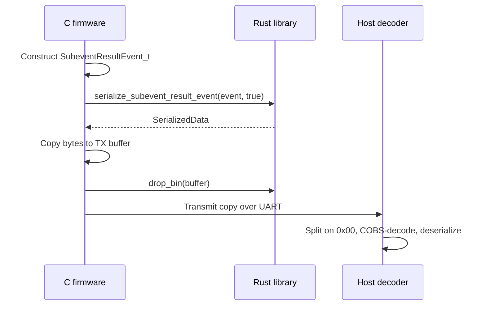

# Architecture overview

For developers integrating, using, or maintaining `mars-bluetooth-hci`. This guide
explains the library's components, API boundaries, and data flow. See
[ecosystem.md](ecosystem.md) for the surrounding firmware and evaluation app.

## System context

The workspace contains two crates:

- `mars-bluetooth-hci` (v0.15.0): parses Bluetooth HCI Channel Sounding (CS) events
  and serializes results through a Rust API and C FFI. Builds as a Rust library
  and `libmars_bluetooth_hci.a`.
- `mars-common` (v0.3.0): provides shared buffer ownership, allocator and panic
  bridges, and logging support.

## The serialize-only FFI boundary

C firmware constructs `SubeventResultEvent_t` using the generated
[header](../mars-bluetooth-hci/mars_bluetooth_hci.h). The FFI exposes serialization
and buffer management; HCI parsing and persisted-frame decoding are Rust-only.

| Function | Purpose |
|---|---|
| `serialize_subevent_result_event` | Serialize an event, optionally with COBS framing. |
| `serialize_log_message` | Serialize a C-string log message, optionally with COBS framing. |
| `drop_bin` | Release a returned buffer. |
| `new_dummy_data` | Allocate deterministic bytes for bring-up tests. |

See [C integration](c-embedded-integration.md) for build and call examples.

## Two ways to build a SubeventResultEvent

### Path A: C firmware

The firmware interprets controller measurements, fills `SubeventResultEvent_t`,
and calls `serialize_subevent_result_event`. It sets the origin, MAC addresses,
counts, and each step's mode-specific payload before serialization.

### Path B: Rust parsing

`SubeventResultEvent::try_from_with_origin(bytes, origin)` parses HCI event bytes
and returns `ParseError` for malformed or unsupported input. It supports Modes
0–3 and invalid-step sentinels. The parser works with `no_std`; the vendor text
file reader, `hci_file_reader`, requires `std`.

## Serialization flow

The serializer borrows the event through `SerializableRef`, encodes it with
postcard, and returns an allocated `SerializedData` buffer. CS serialization
uses a compact, versioned representation independent of the C ABI.

- `use_cobs=true`: COBS framing with a trailing `0x00` delimiter for UART.
- `use_cobs=false`: raw postcard bytes for a consumer that knows the frame boundary.

The owning Rust enum, `Serializable`, decodes the same envelope in host builds.
See [wire-format.md](wire-format.md) for its byte layout.

## mars-common

`SerializedData` transfers an allocated buffer to C without copying. Its pointer,
length, and capacity must remain intact until C releases it with `drop_bin`.
The bytes must be transmitted or copied before release.

For embedded builds, `libc-alloc` forwards allocations to C `malloc`/`free`, and
`libc-panic` calls the firmware's `rust_panic_cb`. Logging uses either `log` or
`defmt`; these features are mutually exclusive. See the
[crate README](../mars-common/README.md) for available features.

### Persisted-frame replay (Rust API only)

`event::hci_le_cs::persisted_frame` provides `encode` and `decode` in host builds
with `std`, `alloc`, and `libc`. It uses the FFI serializer's non-COBS bytes.
Callers store `current_frame_descriptor()` alongside each frame.

Both operations validate event invariants. Decode checks the declared format
and version and requires exactly one CS frame. See
[wire-format.md](wire-format.md#versioning-and-compatibility) for compatibility.

## End-to-end sequence

Firmware may also transmit directly from the returned buffer, provided it waits
for transmission to finish before calling `drop_bin`.

## Known limitations

- MAC addresses come from caller context; the HCI parser leaves them at zero.
- Mode 1 and Mode 3 parsing requires an origin supplied before parsing because
  it determines the timing interpretation. `TryFrom<&[u8]>` uses `Origin::Unknown`
  and therefore rejects those modes. Use `try_from_with_origin` when the role is known.
- Mode 0 infers the role from the step-data length. Mode 3 contains both packet
  timing and tone data.

## Related documents

- [Ecosystem](ecosystem.md): repositories and licensing.
- [C integration](c-embedded-integration.md): build, link, and buffer ownership.
- [Wire format](wire-format.md): framing, payload layout, and compatibility.
- [Wire encoding decision](adr/0001-wire-format-postcard-cobs.md): why postcard and COBS are used.
- [C API design decision](adr/0002-serialize-only-ffi.md): why the FFI exposes serialization only.
- [Persistence design decision](adr/0003-versioned-persisted-frame-codec.md): version selection and migration policy.
- [Contributing](../CONTRIBUTING.md): feature checks and header regeneration.
- [Bluetooth SIG Channel Sounding overview](https://www.bluetooth.com/channel-sounding-tech-overview/): technology background.
