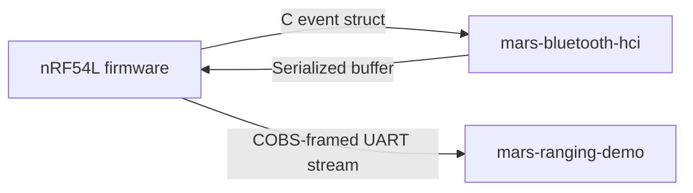

# Ecosystem overview

For people evaluating MARS or getting started with its repositories. The
Metirionic Advanced Ranging Stack (MARS) is a separately licensed product;
these repositories provide its Channel Sounding integration and evaluation tools.

## The three repositories

| Repository | Responsibility | Availability |
|---|---|---|
| [mars-bluetooth-hci](https://github.com/Metirionic/mars-bluetooth-hci) | HCI parsing, event serialization, and a C FFI for firmware. | MIT source |
| [mars-cs-nrf54l](https://github.com/Metirionic/mars-cs-nrf54l) | Nordic nRF54L reference firmware: collect measurements and transmit results over UART. | MIT source |
| [mars-ranging-demo](https://github.com/Metirionic/mars-ranging-demo) | Host GUI: receive, decode, and visualize results. | Public binary releases; closed-source decoder |

The open repositories' MIT licenses do not cover MARS itself. This workspace
contains `mars-bluetooth-hci` and its shared infrastructure crate, `mars-common`.

## Data flow

The firmware constructs an event in C and calls this library's serializer. It
transmits the returned bytes and releases the buffer. The host app decodes the
stream and displays the results. HCI parsing is also available to Rust callers.

The firmware selects the library release through CMake `FetchContent`. Firmware
and host decoders must use compatible releases. This repository defines the
[wire-format contract](wire-format.md) for decoder implementations.

## Next steps

- [Architecture](architecture.md): library components and API boundaries.
- [C integration](c-embedded-integration.md): build and use the library in firmware.
- [Wire format](wire-format.md): implement or maintain a decoder.
- [Firmware architecture](https://github.com/Metirionic/mars-cs-nrf54l/blob/main/docs/architecture.md): device acquisition and transport.
